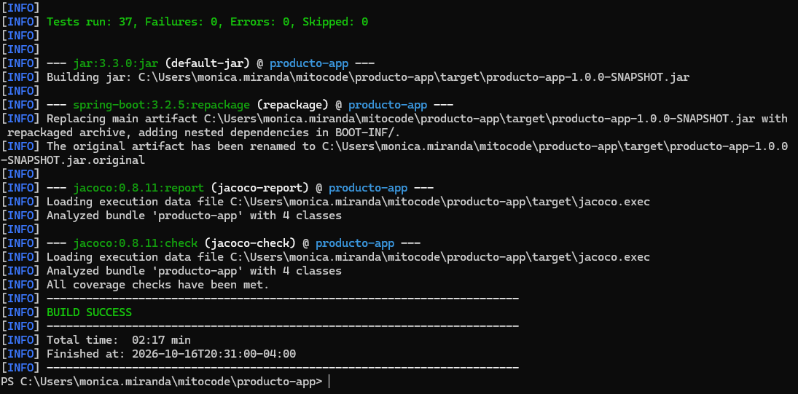

# Aplicación Monolítica Java - CI/CD Pipeline con Jenkins, SonarQube y Artifactory

Proyecto monolítico de gestión de inventario y catálogo de productos desarrollado en **Java 17** y **Spring Boot 3.2.5** con arquitectura en capas, persistencia JPA con base de datos en memoria H2, pruebas automatizadas en JUnit 5 con cobertura JaCoCo, y pipeline declarativo de Integración y Entrega Continua (CI/CD) automatizado en **Jenkins** con análisis estático en **SonarQube** y publicación de artefactos en **JFrog Artifactory**.

---

## 📑 Tabla de Contenidos

1. [Descripción de la Solución](#-descripción-de-la-solución)
2. [Estructura del Repositorio](#-estructura-del-repositorio)
3. [Revisión y Análisis Técnico de Artifactory (docker-compose.yml)](#-revisión-y-análisis-técnico-de-artifactory-docker-composeyml)
4. [Despliegue de Artifactory en Ubuntu 24.04](#-despliegue-de-artifactory-en-ubuntu-2404)
5. [Pipeline CI/CD (Jenkinsfile)](#-pipeline-cicd-jenkinsfile)
6. [Configuración Requerida en Jenkins](#-configuración-requerida-en-jenkins)
7. [Verificación de la Publicación del Artefacto](#-verificación-de-la-publicación-del-artefacto)
8. [Guía de Ejecución Local y Generación de Evidencias](#-guía-de-ejecución-local-y-generación-de-evidencias)
9. [Especificación de la API REST](#-especificación-de-la-api-rest)

---

## 🏛️ Descripción de la Solución

El proyecto implementa una arquitectura monolítica limpia estructurada por responsabilidades:

- **Capa Web / API (`controller`):** Exposición de endpoints RESTful bajo `/api/v1/productos`.
- **Capa de Negocio (`service`):** Validaciones de integridad, reglas de negocio (cálculo de stock, filtros de precio, eliminación lógica).
- **Capa de Persistencia (`repository`):** `ProductoRepository` extendiendo `JpaRepository` con queries derivadas.
- **Modelo de Dominio (`model`):** Entidad `Producto` mapeada con JPA/Hibernate.
- **Testing Automatizado:** 37 pruebas que abarcan pruebas unitarias con Mockito y pruebas de integración WebMvc con MockMvc.
- **Cobertura de Código:** Plugin JaCoCo integrado en fase `verify` con umbral mínimo exigido del 60%.

---

## 📁 Estructura del Repositorio

```
producto-app/
├── artifactory/
│   └── docker-compose.yml              # Definición del servicio JFrog Artifactory OSS y PostgreSQL
├── src/
│   ├── main/
│   │   ├── java/com/example/productos/
│   │   │   ├── ProductosApplication.java
│   │   │   ├── controller/
│   │   │   │   └── ProductoController.java
│   │   │   ├── model/
│   │   │   │   └── Producto.java
│   │   │   ├── repository/
│   │   │   │   └── ProductoRepository.java
│   │   │   └── service/
│   │   │       └── ProductoService.java
│   │   └── resources/
│   │       ├── application.properties
│   │       └── data.sql
│   └── test/
│       └── java/com/example/productos/
│           ├── ProductosApplicationTests.java
│           ├── controller/
│           │   └── ProductoControllerTest.java
│           └── service/
│               └── ProductoServiceTest.java
├── Jenkinsfile                         # Pipeline Declarativo con los 4 stages requeridos
├── pom.xml                             # Configuración Maven, dependencias, JaCoCo y distribución
├── .gitignore
└── README.md
```

---

## 🔍 Revisión y Análisis Técnico de Artifactory (docker-compose.yml)

El archivo `artifactory/docker-compose.yml` gestiona la infraestructura de almacenamiento de artefactos binarios. A continuación se detalla su análisis técnico:

### 1. Servicios Configurados

- **`artifactory-db`**:
  - **Imagen:** `postgres:15-alpine`
  - **Función:** Base de datos relacional para el almacenamiento de esquemas de metadatos, configuración de permisos y trazabilidad de artefactos de Artifactory.
  - **Volumen Persistente:** `artifactory_db_data_v3` montado en `/var/lib/postgresql/data`.
  - **Ajustes de Kernel/Rendimiento:** Configuración de `shared_buffers=512MB`, `work_mem=32MB`, `checkpoint_completion_target=0.9` y `max_wal_size=2GB`.
- **`artifactory`**:
  - **Imagen:** `releases-docker.jfrog.io/jfrog/artifactory-oss:latest`
  - **Función:** Servidor JFrog Artifactory en su versión Open Source Software (OSS).
  - **Volumen Persistente:** `artifactory_data_v3` montado en `/var/opt/jfrog/artifactory`.
  - **Asignación de Recursos:** Límite máximo de 8 GB RAM / 4 CPUs, y reserva de 4 GB RAM / 2 CPUs.
  - **Heap JVM:** `-Xms4g -Xmx4g` configurado en `JF_SHARED_EXTRAJAVAOPTS`.

### 2. Puertos Utilizados

| Puerto Host | Puerto Contenedor | Descripción |
|-------------|-------------------|-------------|
| **8081** | 8081 | **Artifactory Core Service:** Expone la API REST, endpoints de subida y descarga de dependencias Maven/Gradle y comunicación interna. |
| **8082** | 8082 | **JFrog Router / Gateway:** Punto de acceso unificado que sirve la interfaz gráfica de usuario (Web UI) y el enrutador de microservicios. |

### 3. Evaluación de Compatibilidad

- **Compatibilidad con repositorios Maven:**
  La imagen `artifactory-oss:latest` (JFrog Artifactory OSS v7.x) es **100% compatible y adecuada** para este proyecto. Artifactory OSS incluye soporte nativo y completo para repositorios Maven (`libs-release-local` y `libs-snapshot-local`) y Gradle, permitiendo almacenar el JAR empaquetado por Maven y consultar sus metadatos POM.
- **Compatibilidad con Base de Datos PostgreSQL 15:**
  Artifactory 7.x soporta oficialmente PostgreSQL 15. La imagen oficial de Artifactory 7.x incorpora el driver JDBC `org.postgresql.Driver`, garantizando la conexión declarada mediante `JF_SHARED_DATABASE_DRIVER`.
- **Consideraciones de Red y Recursos en Ubuntu 24.04:**
  1. **Red Externa:** El archivo declara `devops-net` como `external: true`. Es mandatorio que dicha red exista antes del inicio del stack (`docker network create devops-net`).
  2. **Consumo de Memoria:** Debido al dimensionamiento de 4 GB de reserva y JVM Heap de 4 GB, en instancias VPS (ej. Linode, AWS EC2, DigitalOcean) de 4 GB de RAM, se debe asegurar la existencia de un archivo de intercambio (Swap de 2 a 4 GB) para evitar que el Kernel Linux cierre el proceso mediante el *OOM Killer*.

---

## 🐧 Despliegue de Artifactory en Ubuntu 24.04

Para iniciar el servicio Artifactory en un servidor Ubuntu 24.04 LTS:

### Paso 1: Instalar Docker y Docker Compose

```bash
sudo apt update && sudo apt install -y docker.io docker-compose-v2
sudo systemctl enable --now docker
sudo usermod -aG docker $USER
```

### Paso 2: Crear la red compartida

```bash
docker network create devops-net
```

### Paso 3: Iniciar el stack de Artifactory

```bash
cd artifactory/
docker compose up -d
```

### Paso 4: Monitorear el inicio del servicio

Artifactory inicializa múltiples microservicios internos (Router, Metadata, Access, Core). Puede tomar entre 2 y 4 minutos:

```bash
docker compose logs -f artifactory
```

Una vez que el log muestre `JFrog Artifactory service is up and ready`, el servicio estará accesible en el navegador:
`http://<IP_DEL_SERVIDOR>:8082`

### Paso 5: Configuración inicial del repositorio Maven

1. Ingresar con las credenciales por defecto:
   - **Usuario:** `admin`
   - **Contraseña:** `password`
2. El asistente de bienvenida solicitará cambiar la contraseña de administración.
3. Crear el repositorio local Maven:
   - Ir a **Administration → Repositories → Repositories → Create Local Repository**.
   - Seleccionar el tipo de paquete **Maven**.
   - Asignar Repository Key: `libs-release-local` (o `libs-snapshot-local` según la versión).
   - Guardar la configuración.

---

## 🔄 Pipeline CI/CD (Jenkinsfile)

El archivo `Jenkinsfile` implementa de forma exacta los **cuatro stages solicitados**:

1. **`Build`**: Compila el código fuente Java con Maven (`mvn clean compile`).
2. **`Testing (JUnit + JaCoCo)`**: Ejecuta las 37 pruebas unitarias y de integración, genera el reporte binario `jacoco.exec`, valida el umbral de cobertura mínima y publica los resultados en Jenkins mediante los plugins `junit` y `jacoco`.
3. **`Sonar`**: Ejecuta el análisis estático de código mediante `mvn sonar:sonar`, enviando métricas y cobertura a SonarQube, y comprueba que el **Quality Gate** haya sido superado dentro de un timeout de 5 minutos.
4. **`Generar artefacto y almacenar en Artifactory`**: Genera el archivo ejecutable `.jar` mediante `mvn package -Dmaven.test.skip=true` y lo publica en el repositorio Maven de JFrog Artifactory utilizando la instrucción oficial `rtUpload` y registra la metadata del build con `rtPublishBuildInfo`.

---

## 🔐 Configuración Requerida en Jenkins

Para ejecutar el pipeline sin exponer secretos en el código fuente, configure en Jenkins lo siguiente:

### 1. Herramientas Globales (Manage Jenkins → Tools)

- **JDK:**
  - **Name:** `JDK-17`
  - **JAVA_HOME:** Ruta al JDK 17 (o instalación automática).
- **Maven:**
  - **Name:** `Maven-3.9`
  - **MAVEN_HOME:** Ruta al Maven 3.9+ (o instalación automática).

### 2. Credenciales (Manage Jenkins → Credentials → System → Global credentials)

| ID de Credencial | Tipo | Descripción |
|------------------|------|-------------|
| `sonar-auth-token` | **Secret text** | Token de análisis generado en la cuenta de SonarQube. |
| `artifactory-credentials` | **Username with password** | Usuario y contraseña con permisos de despliegue en Artifactory. |

### 3. Configuración de Servidores (Manage Jenkins → System)

- **SonarQube Servers:**
  - **Name:** `SonarQube` *(debe coincidir con el llamado `withSonarQubeEnv('SonarQube')`)*
  - **Server URL:** `http://<IP_O_HOST_SONARQUBE>:9000`
  - **Server authentication token:** Seleccionar `sonar-auth-token`.
- **JFrog Artifactory Servers (Plugin JFrog):**
  - **Server ID:** `Artifactory` *(debe coincidir con la variable `ARTIFACTORY_SERVER`)*
  - **JFrog Platform URL:** `http://<IP_O_HOST_ARTIFACTORY>:8082`
  - **Artifactory URL:** `http://<IP_O_HOST_ARTIFACTORY>:8082/artifactory`
  - **Credentials:** Seleccionar `artifactory-credentials`.

### 4. Variables de Entorno del Pipeline

Definidas centralizadamente en la sección `environment` del `Jenkinsfile`:

- `APP_NAME`: `producto-app`
- `SONAR_PROJECT_KEY`: `producto-app`
- `SONAR_PROJECT_NAME`: `producto-app`
- `ARTIFACTORY_SERVER`: `Artifactory`
- `ARTIFACTORY_REPO`: `libs-release-local`

---

## ✅ Verificación de la Publicación del Artefacto

Para comprobar que el JAR fue publicado exitosamente en Artifactory, se pueden emplear dos métodos:

### Método 1: Verificación gráfica en Artifactory Web UI

1. Iniciar sesión en Artifactory (`http://<IP_O_HOST_ARTIFACTORY>:8082`).
2. Navegar a **Application → Artifactory → Artifacts**.
3. Expandir el árbol de repositorios y ubicar:
   ```
   libs-release-local/
   └── com/
       └── example/
           └── producto-app/
               └── <BUILD_NUMBER>/
                   ├── producto-app-1.0.0-SNAPSHOT.jar
                   └── producto-app-1.0.0-SNAPSHOT.pom (si aplica)
   ```
4. Seleccionar el archivo JAR y verificar la pestaña **General Info** (tamaño en bytes, Checksum SHA-256, fecha de subida) y la pestaña **Builds** asociada al número de build de Jenkins.

### Método 2: Verificación por API REST / cURL

Ejecutar la consulta autenticada al endpoint de almacenamiento:

```bash
curl -u <USUARIO>:<PASSWORD> \
  -X GET "http://<IP_O_HOST_ARTIFACTORY>:8082/artifactory/api/storage/libs-release-local/com/example/producto-app/<BUILD_NUMBER>/producto-app-1.0.0-SNAPSHOT.jar"
```

Una respuesta HTTP `200 OK` con el JSON de metadatos del archivo confirma la correcta publicación.

---

## 📸 Guía de Ejecución Local y Generación de Evidencias

Para armar el informe de evidencias solicitado para la entrega del proyecto:

### 1. Evidencia de Compilación y Pruebas Unitarias (Build & Testing)

Ejecutar en la terminal del proyecto:

```bash
mvn clean verify
```

**Capturas requeridas:**




### 2. Evidencia de Análisis Estático (SonarQube)

```bash
mvn sonar:sonar \
  -Dsonar.host.url=http://localhost:9000 \
  -Dsonar.login=$env:SONAR_TOKEN
```

**Capturas requeridas:**


---

## 🌐 Especificación de la API REST

Base URL: `http://localhost:8080/api/v1/productos`

| Método | Endpoint | Descripción |
|--------|----------|-------------|
| `GET` | `/api/v1/productos` | Lista todos los productos registrados |
| `GET` | `/api/v1/productos?soloActivos=true` | Filtra únicamente los productos con estado activo |
| `GET` | `/api/v1/productos/{id}` | Obtiene los detalles de un producto por identificador |
| `GET` | `/api/v1/productos/buscar?nombre={txt}` | Búsqueda por coincidencia de nombre |
| `GET` | `/api/v1/productos/categoria/{cat}` | Filtrado por categoría |
| `GET` | `/api/v1/productos/precio?min={x}&max={y}` | Filtrado por rango de precios |
| `GET` | `/api/v1/productos/stock-bajo?umbral={n}` | Alerta de productos con existencias menores o iguales al umbral |
| `POST` | `/api/v1/productos` | Registra un nuevo producto en el catálogo |
| `PUT` | `/api/v1/productos/{id}` | Actualiza todos los campos de un producto existente |
| `PATCH` | `/api/v1/productos/{id}/stock` | Actualización puntual del nivel de stock |
| `DELETE` | `/api/v1/productos/{id}` | Desactivación lógica del producto |
| `DELETE` | `/api/v1/productos/{id}/fisico` | Eliminación permanente del registro |
